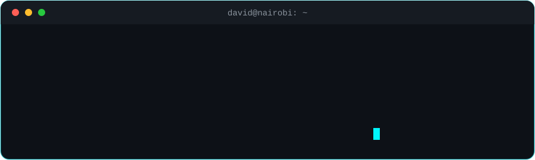
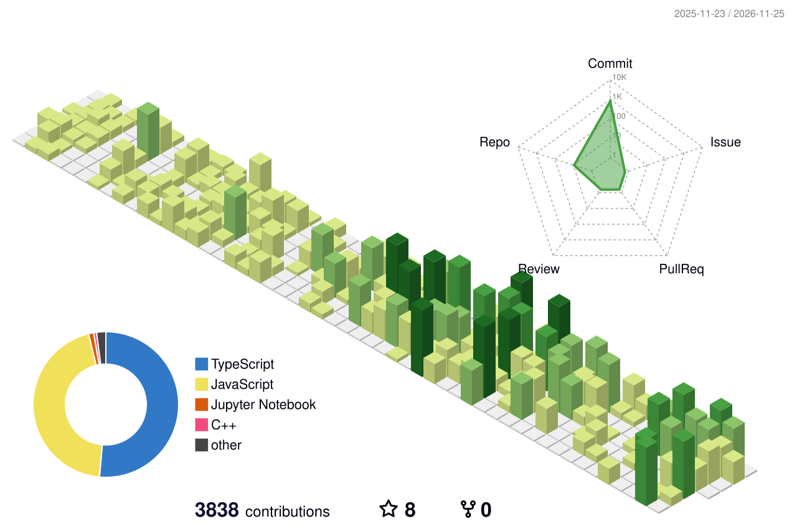
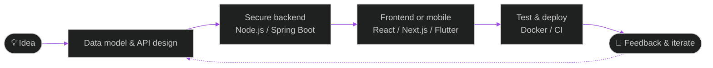

<!-- 3D rotating hero (file: assets/hero.svg) -->

  

  

**[About](#about) &nbsp;•&nbsp; [Stack](#stack) &nbsp;•&nbsp; [Projects](#projects) &nbsp;•&nbsp; [3D Graph](#graph) &nbsp;•&nbsp; [Stats](#stats) &nbsp;•&nbsp; [Workflow](#build) &nbsp;•&nbsp; [Exploring](#explore) &nbsp;•&nbsp; [Contact](#connect)**

 

  

 

I build practical software that solves real problems, from healthcare and agriculture to platforms that connect people and opportunity across Africa. I care about clean architecture, secure-by-default design, and shipping things people actually use.

| 📍 Based in | 🎯 Focus | 🌱 Learning | 🤝 Open to |
|:--:|:--:|:--:|:--:|
| Nairobi, Kenya | Backend & APIs | AI/ML integration | Internships, collabs, open source |

<a href="#top">⬆ back to top</a>

| Area | Technologies |
|:--|:--|
| **Frontend** |  |
| **Backend** |  |
| **AI / ML** |  |
| **Databases** |  |
| **DevOps & Tools** |  |

| ⚙️ Backend | 🤖 AI Integration | 🔐 Security Mindset | ML pipelines | Data Engineer |
|:--|:--|:--|
| REST APIs, authentication, validation and database design with Node.js/Express and Spring Boot | Adding AI and computer vision to real products through APIs and models | Building with secure defaults: validated input, proper auth, careful data handling |

<a href="#top">⬆ back to top</a>

Click any card to open the repository.

 

<b>Kisii University web</b>: Modern Kisii University web

 

  

- ⚡ Clear and modern UI
- 📍 clear user interaction
- 🔐 Secure handling of sensitive user data

[🔗 View Repository](https://github.com/Daudicode12/blood-donation-with-next.js)

<b>🌱 CropCare AI</b>: crop health diagnostics for farmers

 

  

- 🔬 Disease detection from plant photos using computer vision
- 🐛 Pest identification
- 💊 Treatment recommendations
- 📈 Crop health analytics over time

[🔗 View Repository](https://github.com/ipkoech/ksu-website.git)

<b>🌾 AgroVault</b>: direct farmer-to-market platform

 

  

- 💰 Transparent pricing and market insights
- 🤝 Direct farmer-buyer connections
- 📦 Supply chain visibility
- 📊 Commodity price tracking

[🔗 View Repository](https://github.com/Daudicode12/Agrivault)

<b>💬 Quantum Chatbot AI</b>: conversational engine

 

 

- 🧠 Context-aware conversations
- 🌐 Multi-language support
- 📚 Knowledge-base integration
- ⚡ Real-time responses over WebSockets

<a href="#top">⬆ back to top</a>

<!-- Generated daily by .github/workflows/profile-3d.yml (run it once manually first) -->

 

<a href="#top">⬆ back to top</a>

<a href="#top">⬆ back to top</a>

| Track | What I'm working on |
|:--|:--|
| 🤖 **AI/ML** | Integrating models into production backends |
| 🧱 **Architecture** | Microservices and distributed systems |
| 🔐 **Security** | Application security and ethical pentesting |
| ☁️ **Deployment** | Serverless and edge strategies |
| ⚡ **Performance** | WebAssembly for high-performance web apps |

**Open to collaboration, internships and meaningful projects. Let's build something that matters.**

 

  

